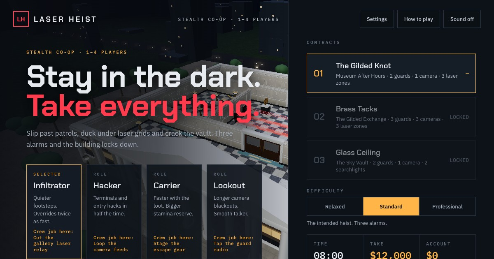

# Laser Heist

A stealth heist game in the browser. Plan three scores, slip past guards and laser grids, talk your way out when you're caught, and lose the cops in the getaway.



**Play it in your browser: https://tarunt27.github.io/laser-heist/**. The full solo campaign runs there. Online co-op rooms need the Node server below.

## Play

```sh
npm install
npm run build
PORT=3011 npm start
```

Open http://localhost:3011/. Needs Node 22+. For quick solo play during development, `npx vite --port 5179` and open http://localhost:5179/ (online rooms need `npm start`).

## The game

- **A campaign of three heists.** The Gilded Knot (museum), Brass Tacks (bank vault) and Glass Ceiling (rooftop power core). Each heist board lets you pick an approach, run that approach's setup mission (plus an optional scouting job), and hire a hacker and a getaway driver who take a cut. Clearing a heist unlocks the next; the third ends the campaign.
- **Stealth.** Guards see in cones that walls and doors block; crouching shortens how far they see and makes you silent; low cover hides you while crouched. A suspicion circle around your crosshair shows who's watching. Fill it and the guard stops you: press Space with the needle in the green to bluff your way out (twice per guard, the second time harder). Miss and you're busted. Take unaware guards down from behind. Cameras and lasers raise alarms; three and the building locks down.
- **Crew jobs.** Every role has one optional job per map that gives the whole crew a perk for the rest of the run.
- **The getaway.** Van heists end in a night-city police chase: break line of sight until the police lose you, then drive to the getaway house. The Sky Vault ends by helicopter.
- **Difficulty.** Relaxed, Standard and Professional change guard sight and reactions, alarms allowed, the clock and the getaway's wanted level.
- **Online co-op.** Create a private room for 1–4 players, pick roles on the crew-select screen, agree the split and play a heist together (the campaign itself is solo).

## Controls

| | Keyboard and mouse | Touch |
| --- | --- | --- |
| Move / look | WASD, mouse (click the game to capture it) | Arrow pad, drag |
| Sprint / crouch | Shift / C | Crouch button |
| Use, hold to work | E | Hold to use |
| Takedown | F | Takedown button |
| Bluff when stopped | Space | Talk button |
| Map / ping / pause | M / P / Esc | Map button |
| Drive (getaway) | W/S, A/D, Space handbrake | Gas, brake, ◀ ▶ |

## How it's checked

`npm run check` runs the typecheck, the test suite and the production build. The suite includes bots that play with guards, cameras, lasers and police switched on, using only real inputs. They prove every finale and setup can be won on Relaxed, the museum, the bank and every required setup on Standard, and the getaway at 1 and 3 wanted stars. Run them yourself with `npx tsx tools/heist-playthrough.ts --difficulty=standard` (add `--setups` for the setup missions) and `npx tsx tools/getaway-playthrough.ts`. `npx tsx tools/heist-difficulty.ts` measures how exposed every job and doorway is to guards.

## Deploy

`render.yaml` deploys to Render as a Node web service (`npm start`, health check at `/health`). Any host that runs a persistent Node process with WebSockets works. A static-only host can serve the built `dist/` for solo play, but not online rooms.

## Project layout

- `client/heist/`: game UI, renderer, getaway drive (`getaway.ts`, `getaway-sim.ts`) and campaign save.
- `shared/`: the rules both the browser and the server run: `heist.ts` (simulation, guards, bluffing), `heist-maps.ts` (map layouts), `heist-campaign.ts` (heists, setups, crew).
- `server/`: Node HTTP and WebSocket server for online rooms, and the tests.
- `tools/`: Blender build scripts (`build_heist_hd.py` for the three heist locations, `build_getaway_city.py` for the city), map/layout exporters and the playthrough bots.
- `public/heist/`: runtime models and images. `art/`: editable `.blend` sources, previews and retired assets (`art/legacy/`).
- `docs/laser/IMPLEMENTATION.md`: design notes, rebuild commands and verification history.

The repository also contains an earlier game, Orbit Knockout, at `/orbit/`.

## Credits

Game design, code, Blender environments and the getaway city were made for this project. The crew character is based on Quaternius's CC0 Universal Base Characters and Universal Animation Library (see `public/heist/crew_README.md`). Rendering by three.js; mesh compression by Draco. Earnings in the game are fictional currency.
